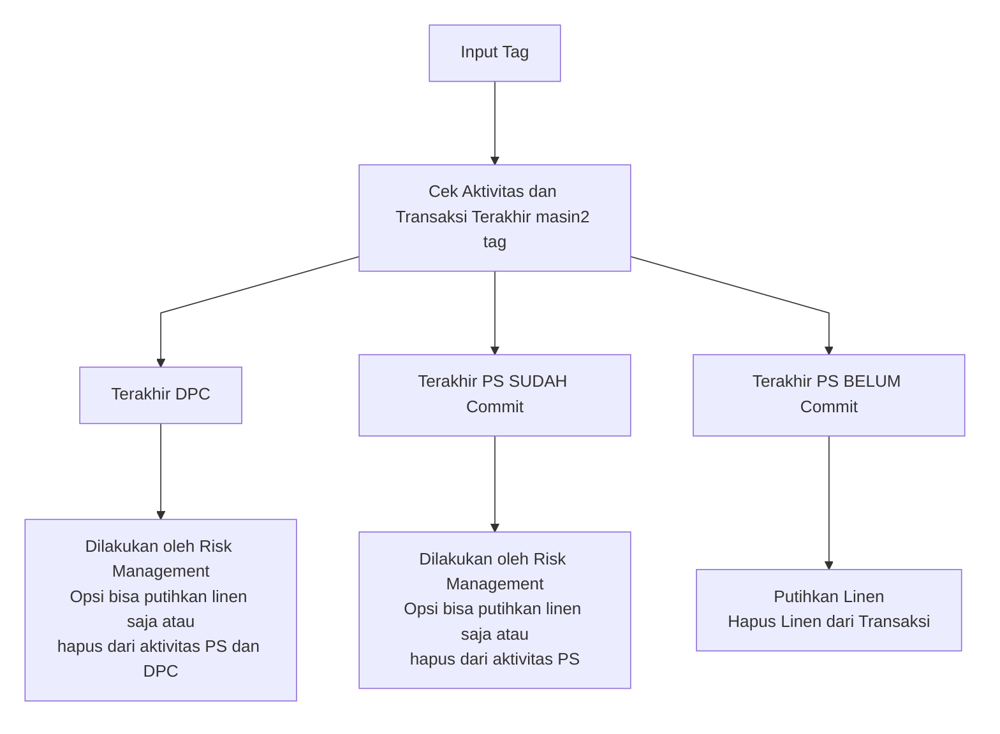

# Cancel Packing

## Cakupan

## Cancel Packing

Input: `tag_id` (scan maupun ketik manual) + reason

## Discussions

- historis linen dicatat
- setiap tag -1 Wash Cycle
- Mencatat Transaksi pembuatan Cancel Packing
- Jika melakukan PS SUDAH Commmit dan/atau DPC maka commit harus di-cancel
